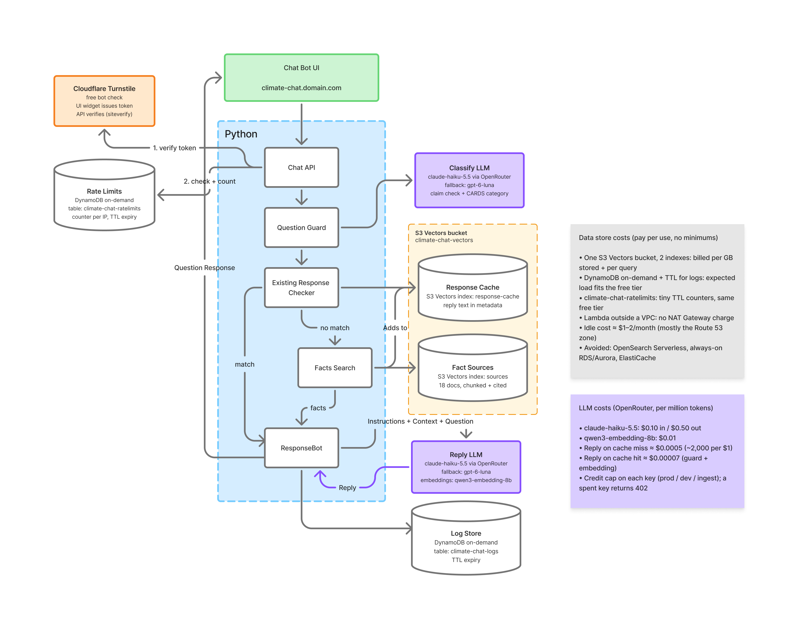

# Climate Bot: design decisions



Working record of decisions made while fleshing out the design. Diagram: StateFlow FigJam board, "Climate Bot v2: Data Stores".

## Principles

- **Pay per use, no minimum charges.** Every service must cost (close to) nothing when idle.
- **Own repo, own infra.** This project has its own Terraform state and its own Route 53 hosted zone for `climate-chat.<domain>`. The website repo only adds the NS delegation record.

## Data stores

| Diagram box | Service | Name |
|---|---|---|
| Response Cache | S3 Vectors index, keyed on the embedded **normalised claim**; the style-neutral **answer card** is stored as non-filterable metadata | bucket `climate-chat-vectors`, index `response-cache` |
| Fact Sources | S3 Vectors index; chunk text, source number and citation URL in metadata | bucket `climate-chat-vectors`, index `sources` |
| Log Store | DynamoDB on-demand, TTL on log items. See [Request logs](#request-logs) | table `climate-chat-logs` |
| Rate Limits | DynamoDB on-demand, one counter item per IP per time window, TTL expiry | table `climate-chat-ratelimits` |

- Compute: Lambda **outside a VPC** (no NAT Gateway). Static UI on S3 + CloudFront.
- Avoided because of minimum charges: OpenSearch Serverless, always-on RDS/Aurora, ElastiCache, NAT Gateway.
- Expected idle cost: about $1–2/month, mostly the Route 53 hosted zone.

## Front end and API

**No separate backend for the front end (no BFF).** The UI talks directly to the Python service. A BFF would only pay off with user logins, several backends to combine, server-side rendering for SEO, or secrets to keep out of the browser, and none of those apply here.

```
climate-chat.<domain>  →  CloudFront
                           ├─ /*      → S3 (static Solid single-page app)
                           └─ /api/*  → Lambda function URL (Python service)
```

- **UI:** plain **Solid 2 + Vite** single-page app (`solid-js` 2.0.3 and `vite-plugin-solid` 2.11.17 were current on npm on 2026-11-22). SolidStart isn't used, because its value is server rendering and server functions.
- **One domain:** CloudFront sends `/api/*` to the Lambda function URL, so no CORS setup is needed. The function URL is locked to CloudFront with Origin Access Control (OAC), so direct calls are refused.
- **API routes:**
  - `POST /api/chat`: takes `{ comment, turnstile_token, platform?, style?, subject?, thread? }` and returns `{ reply, citations, fallacy, cached }`. See [Two-stage reply](#two-stage-reply-facts-then-tone) for `platform` and `style`, and [Comment context](#comment-context) for `subject` and `thread`.
  - `GET /api/sources` (optional, not in v1): returns the source list with links for the UI
- **Every `POST` must send `x-amz-content-sha256`**, the hex SHA-256 of the request body. CloudFront's OAC signs the origin request to the function URL with it and doesn't hash bodies itself; without it the function URL refuses the request with a 403 that has no JSON error code. The UI computes it with `crypto.subtle.digest`.
- **Errors** are JSON `{ "error": "<code>", "message": "<text>" }`:

  | Status | When |
  |---|---|
  | 400 | Bad JSON, an unknown `style` or `platform`, or a `comment`, `subject` or `thread` over its length cap (`comment_too_long`, `subject_too_long`, `thread_too_long`) |
  | 403 | Missing or failed Turnstile token |
  | 404 / 405 | Unknown path, or a method other than `POST` on `/api/chat` |
  | 429 | Rate limit reached |
  | 500 | An unexpected error (details are logged, never returned) |
  | 502 | A model call failed, or its output failed the code checks after one retry |
  | 503 | The OpenRouter key's credit cap is spent ("can't answer right now") |

- **A comment that isn't a climate-sceptic claim** gets HTTP 200 with a fixed, polite reply, empty `citations` and `fallacy: null`, so the UI handles one success shape.
- **A comment OpenRouter refuses** (HTTP 403, e.g. "prompt injection patterns detected") gets the same shape with the fixed reply "Sorry, I can't reply to that comment.", logged with outcome `blocked`. Retrying wouldn't help, so it isn't an error.
- **Smoke test event.** Besides function URL requests, the handler accepts a direct Lambda invoke `{"smoke": "<comment>"}` and runs it through the pipeline from Classify on, skipping Turnstile and the rate limit. Only IAM principals can invoke the function directly: the function URL is locked to CloudFront, and function URL events always carry `requestContext.http`, so a public request can't produce this event. It lets the deployed service be tested end to end without a real Turnstile token.
- **No streaming:** replies are short (~300 tokens), and Lambda's Python runtime doesn't support response streaming natively. The UI shows a typing indicator while it waits.

### Abuse protection for the anonymous endpoint

Anyone can call `/api/chat`, and every cache miss costs money. Protection is layered, and almost all of it is free. The service runs the checks in this order, cheapest first, and all of them before any LLM call:

1. **Length caps**: `comment` ~1,000 characters, `subject` ~300, `thread` ~1,000. Free and needs no network call.
2. **Cloudflare Turnstile check** (free): see below.
3. **Per-IP rate limit** in the Python service, using counters in the `climate-chat-ratelimits` table (e.g. 10 requests/minute, 100/day). There is one item per IP per window (`ip#<ip>#m#<minute>` and `ip#<ip>#d#<day>`), incremented by a conditional `UpdateItem` (`ADD count :1` if `count < limit`); a failed condition is a 429. Each item expires via TTL. The IP comes from the `CloudFront-Viewer-Address` header with the port stripped.
4. **Lambda reserved concurrency** to cap how many requests run at once.
5. **OpenRouter key credit cap** as the hard limit on spending.

AWS WAF with CAPTCHA was considered and not chosen: it costs at least $5/month and Turnstile does the same job for free.

### Cloudflare Turnstile

Turnstile is Cloudflare's free bot check. It works on any site, so the domain doesn't need to be on Cloudflare DNS.

1. The Solid app renders the Turnstile widget in **managed mode**, so most people never see a challenge. The widget uses the public **site key**, which is baked into the UI build.
2. Each `POST /api/chat` sends the widget's token with the comment: `{ comment, turnstile_token }`.
3. The Python service verifies the token with Cloudflare's `siteverify` endpoint, using the private **secret key**, **before** the rate limit, the cache lookup or any LLM call. A missing or failed token returns HTTP 403.
4. Tokens are single-use and expire after 5 minutes, so the UI requests a fresh token for each message.

The secret key is stored like the OpenRouter keys (see Secrets).

## LLM (OpenRouter)

All model calls go through OpenRouter's OpenAI-compatible API (`https://openrouter.ai/api/v1`), using the OpenAI Python SDK.

### Models

Prices are per million tokens (input / output), from OpenRouter's public model list on 2026-11-22.

| Role | Model | Price | Why |
|---|---|---|---|
| Classify LLM (Question Guard) | `anthropic/claude-haiku-5.5` | $0.10 / $0.50 | Strong instruction-following and resistance to prompt injection. A classify call is ~400 tokens in, ~120 out, so a cheaper model would save under $0.0001 per call. |
| Facts LLM | `anthropic/claude-haiku-5.5` | $0.10 / $0.50 | Best quality in the low-cost tier. Supports structured outputs. |
| ResponseBot LLM (tone) | `anthropic/claude-haiku-5.5` | $0.10 / $0.50 | Good at matching register in short text. One model for all three roles keeps prompts and testing simple. |
| Fallback (all three) | `openai/gpt-6-luna` | $0.10 / $0.50 | Same price tier, different vendor, so an Anthropic outage doesn't take the bot down. |
| Embeddings | `openai/text-embedding-3-small` | $0.02 | Won the retrieval bake-off: all 20 test myths found their sources, with 0.4 s median query latency. |

**Embedding choice: settled by a bake-off** (plan 02, Phase 4). Both candidates embedded the 1,811-chunk corpus, then 20 known myths were searched against each in memory:

| Model | recall@5 | MRR | Query latency p50 / p95 |
|---|---|---|---|
| `openai/text-embedding-3-small` (1536-d) | **20/20** | 0.94 | **0.37 s / 0.70 s** |
| `qwen/qwen3-embedding-8b` (4096-d) | 19/20 | 0.93 | 3.68 s / 12.2 s |

Qwen3 was ruled out on latency alone: the service embeds every incoming claim inside its 4–6 s reply budget, and its p95 on OpenRouter was over 12 s. Retrieval quality was effectively equal. The smaller vectors also make each S3 Vectors query about 2.7× cheaper, which outweighs the $0.01 per million tokens Qwen3 saves.

Embeddings cannot use a fallback model. Both indexes must be built and queried with the same model, and changing it means re-embedding everything (cheap at this corpus size).

Model IDs live in config (environment variables), not code, so they can change without a deploy. The fallback goes in OpenRouter's `models` list on each request.

**Structured output.** Classify, Facts and Reply return JSON, using OpenRouter's JSON-schema `response_format` with `provider.require_parameters: true`, so only providers that enforce the schema are used. Both Haiku 5.5 and the fallback support it (plan 03, Phase 0). Output that still fails to parse is retried once.

**No `temperature`.** Neither Haiku 5.5 nor the fallback supports it: with `require_parameters` a request that sets it finds no provider (HTTP 404), and without it OpenRouter silently drops it.

### Cost and latency per reply

Measured in plan 03 (prod logs and the dev reply evaluation, 2026-11-24), with reasoning off. Costs are OpenRouter's `usage.cost`.

| Call | Tokens in / out (measured) | Cost (measured) |
|---|---|---|
| Classify LLM | ~970 in (instructions + comment), ~105 out | ~$0.00015 |
| Claim embedding | ~15 | under $0.000001 |
| Facts LLM (cache miss only) | ~4,500 in (instructions + 5 chunks), 390–610 out | ~$0.00065 |
| ResponseBot LLM | ~1,000–1,200 in (comment + tone + answer card), 120–200 out | ~$0.00017 |
| **Total, cache miss** | 3 LLM calls, **5–8.6 s** | **~$0.0010** (about 1,000 replies per $1) |
| **Total, cache hit** | 2 LLM calls, **2.3–4.4 s** | **~$0.0003** (about 3,000 replies per $1) |

- **About 40% more per reply than first estimated** (~$0.0007 per miss, ~$0.00024 per hit). The prompts are longer than assumed: Classify carries the CARDS and tone instructions, and Facts carries five ~500-token chunks.
- **A cache miss is slower than the 4–6 s target**, mostly the Facts call. It's well within the Lambda's 30 s timeout and CloudFront's 30 s origin timeout. The UI shows a typing indicator while it waits.
- **Comment context** (`subject`, `thread`) adds up to ~400 input tokens to Classify and ResponseBot at the caps, about $0.00008 per reply.
- **A retried call adds its cost again**: a failed check retries once, so the worst case for a miss is about $0.0017.
- **The cache saves less than first hoped**, because the strict 0.15 threshold only matches near-identical claims (see [Response cache writes](#response-cache-writes)).

One-off ingestion, measured in plan 02: 28 sources, 1,811 chunks, 823k tokens of `text-embedding-3-small` embeddings, about $0.02. Re-ingesting a changed source costs a fraction of a cent, since unchanged chunks come from the cache.

### Cost and abuse controls

- **A credit cap on each OpenRouter key.** Separate keys for `prod`, `dev` and `ingest`. A spent key returns HTTP 402, and the bot replies "can't answer right now".
- `max_tokens` on every call, to cap the output length and cost. The values are config and are tuned by testing. **Current: classify 200, facts 1000, reply 300.** Measured in plan 03 (Phase 4, 52 calls) with reasoning off: classify at most 118 output tokens, facts at most 613, reply at most 198. Design.md's first guesses (150 / 500 / 200) cut Facts cards off mid-JSON and left Reply no margin.
- **Reasoning off** (`reasoning: {enabled: false}`) on every call. With reasoning on, Haiku spent 0–114 hidden tokens per call, which count against `max_tokens`: at 150 the answer was cut off, and `reasoning: {max_tokens: 0}` used the whole cap on reasoning and returned nothing. With it off, 21 of 21 calls used no reasoning tokens and Classify took 0.6–1.8 s. Whether Facts writes better cards with reasoning on is checked when tuning.
- API key stored as an SSM Parameter Store SecureString (free tier), not Secrets Manager.
- Token usage and cost from each response's `usage` field written to `climate-chat-logs` (see [Request logs](#request-logs)).
- Provider routing set to deny data collection and prefer providers that don't retain data.

## Two-stage reply: facts, then tone

Finding the facts and writing the reply are separate LLM stages. The facts are neutral and cached; the tone is applied fresh for every comment.

```
comment ─► Classify LLM ─► normalised claim + CARDS category + tone profile
               │
               ▼
        embed claim ─► Response Cache ──hit──────────────┐
               │ miss                                    │
               ▼                                         ▼
        Facts Search ─► Facts LLM ─► answer card ─► ResponseBot LLM ─► reply
                                        │            (tone + style)
                                        └─► write to cache
```

### Comment context

A comment often only makes sense next to what it's replying to. Two optional free-text fields carry that:

- **`subject`** (up to ~300 characters): what the comment is under, e.g. a video title, a post's description or the topic being discussed. Example: `"YouTube: Our heat pump after one UK winter in a 1930s semi"`.
- **`thread`** (up to ~1,000 characters): the message the comment replies to, if any.

Both are typed or pasted by the user, and are usually copied from strangers, so **both are treated as an attack vector**, exactly like the comment:

- Trimmed, normalised to NFC and capped (400 if over) before Turnstile; an empty string counts as absent.
- Only ever placed in the user message, inside their own tags (`<subject>`, `<thread>`). Every untrusted block has **all** of the prompt's tag names defused (`</comment`, `</subject`, `</thread`, `</source`, `</card` → `<\/…`), so no block can close another or fake one.
- Never in a system message, and never allowed to change the rules. The prompts say instructions inside any block are data.
- OpenRouter's own injection block, and every code check on the outputs, apply as before.

**Where they're used:**

| Call | Gets the context? | Why |
|---|---|---|
| Classify | Yes, both | To resolve what the comment means. The claim must still be the commenter's |
| Claim embedding, cache, Facts Search, Facts | No | They work from the restated claim, which already carries the useful part ("heat pumps", "UK winters"). Cards stay neutral, and one card keeps serving every wording and every video |
| ResponseBot | Yes, both | To answer in context ("for a 1930s semi, …") and to address the commenter, not the thread's author |

**Classify rules for context:**

- The claim is what **the commenter** asserts. `subject` and `thread` only resolve references ("it", "mine", "this", "they") and missing topic words. The restated claim must stand on its own, e.g. "Heat pumps don't work in cold UK winters".
- A comment that only **endorses** a sceptical claim in `thread` ("This.", "Exactly 👆", "finally someone says it") makes that claim the commenter's.
- A comment that **disputes** a sceptical thread, or a sceptical subject with a neutral comment, is not a sceptical claim. The bot answers commenters, not videos.

**ResponseBot rules for context:** it may refer to the subject briefly, it doesn't quote or answer the thread's author, and facts still come only from the card.

### 1. Classify LLM

One call returns:

- **Verdict:** is it a climate claim, and does it present a sceptical view? If not, no further LLM calls are made, and the API returns the fixed not-a-claim reply.
- **`cards_category`:** the claim's category in the CARDS taxonomy (Coan et al. 2021).
- **`claim`:** the comment restated as one neutral sentence, e.g. "Solar is pointless because it doesn't generate at night".
- **`tone`:** register (casual / formal), hostility (none / mild / hostile), emoji and slang use, language.

**The cache lookup embeds the normalised `claim`, not the raw comment.** "lol solar is useless at night 🙄" and a formal version of the same point then match the same cache entry, instead of differences in tone pushing the similarity score down.

### 2. Facts LLM (cache miss only)

Input: the claim plus the top 5 retrieved source chunks. Output: a style-neutral **answer card**:

```json
{ "claim": "...", "cards_category": "...", "fallacy": "...",
  "key_points": [{ "point": "...", "source_ids": ["..."] }],
  "bottom_line": "...", "confidence": 0.0 }
```

- Key points follow the Debunking Handbook 2020 order: **fact → warning → fallacy → fact**.
- **Citation check in code:** every `source_id` must be one of the retrieved chunks, or the card is rejected.
- **`fallacy` is a short label** (at most four words, e.g. "Cherry picking"), or null, because the API returns it for the UI to show. A longer one fails the card check.
- The answer card is what goes into the cache, so one card serves every future wording of the claim.
- **Source licences.** Every chunk carries a filterable `licence` value. The `EXCLUDED_LICENCES` setting (comma-separated, empty by default) adds a `licence` `$nin` filter to the Facts Search, so which sources may be quoted is a config change, not a code change. Which licences to exclude is still open; it must be decided before launch.

### 3. ResponseBot LLM (every reply)

Input: the original comment, the tone profile, the answer card, `style` and `platform`. Output: `{ reply, source_ids }`.

- **Locked to the card's facts.** The prompt forbids new claims, and two code checks enforce it:
  - The reply's `source_ids` must be a subset of the card's.
  - **Every number in the reply must appear in the answer card** (regex check). This catches made-up statistics.
- **Matches register, not hostility.** A casual comment gets a casual reply; a hostile comment gets a calm, firm reply. The bot never insults or mocks the person.
- **Length set by `platform`:** `x` 280 characters, `youtube` / `facebook` 500. The default is 280. A code check enforces it: a longer reply is retried once, like the other reply checks.

### Styles

`style` is in the API from the start, so cached cards never need rebuilding when styles are added.

| `style` | Phase |
|---|---|
| `match` (default): mirrors the commenter's register | Now |
| `neutral`: plain and factual | Now |
| `casual`: "LOL, …" | Later |
| `sarcastic` | Later. Sarcasm targets the argument, never the person, and uses no profanity |

### Retries

A model call whose output doesn't parse, or fails its code check (citations, numbers, length, fallacy label), is retried **once**. The retry sends the failed output back with the list of problems, so the model can correct it rather than guess again. A second failure is a 502. Every attempt's tokens and cost are logged.

### Speed

The steps run one after another: Classify, then the claim embedding, then the cache lookup. The Facts Search only runs on a cache miss, so a hit makes no wasted query.

## Secrets

The secrets are the **OpenRouter API keys** (`prod`, `dev`, `ingest`), the **Cloudflare Turnstile secret key** and the **log-hash key** (see [Request logs](#request-logs)). The Turnstile site key is public and lives in the UI build. The Python service reaches S3 Vectors and DynamoDB through its Lambda IAM role, so no AWS keys are stored anywhere.

### Where they live

**SSM Parameter Store, SecureString, standard tier.** Storage and normal API calls are free, and encryption uses the free AWS-managed `aws/ssm` key.

Secrets Manager was not chosen. It costs $0.40 per secret per month plus API charges, and its main extra, automatic rotation, can't be used with OpenRouter keys.

| Parameter | Used by |
|---|---|
| `/climate-chat/prod/openrouter-api-key` | Python service (Lambda) |
| `/climate-chat/dev/openrouter-api-key` | Shared dev copy. Local development reads the key from a gitignored `.env` |
| `/climate-chat/prod/turnstile-secret-key` | Python service (Lambda) |
| `/climate-chat/prod/log-hash-key` | Python service (Lambda) |
| `/climate-chat/dev/log-hash-key` | Shared dev copy. Local development reads it from `.env` |
| `/climate-chat/ingest/openrouter-api-key` | Ingestion script, using your own AWS credentials (or a GitHub Actions OIDC role if run in CI) |

### Rules

1. **Terraform creates the parameter, never the value.** Values in Terraform end up in plain text in the state file. Each parameter is created with a placeholder and `lifecycle { ignore_changes = [value] }`. The real value is set once, outside Terraform:

   ```bash
   aws ssm put-parameter --name /climate-chat/prod/openrouter-api-key --type SecureString --value "<key>" --overwrite
   ```

2. **No secrets in Lambda environment variables.** They are visible in the console and in Terraform state. The service reads the key with boto3 (`get_parameter`, `WithDecryption=True`) when it starts, and caches it in memory for about 5 minutes.
3. **Least-privilege IAM.** The Lambda role gets `ssm:GetParameter` on the three prod parameters' ARNs only, plus `kms:Decrypt` on the `aws/ssm` key.

### Rotating a key and limiting damage

- **To rotate:** create a new key in OpenRouter, overwrite the parameter, and revoke the old key. The service picks up the new key within the 5-minute cache window, with no deploy.
- **If a key leaks:** each key's OpenRouter credit cap limits the most it can cost. Separate keys mean a leaked dev or ingest key doesn't affect prod.

**Cost: $0.**

## Response cache writes

**A lookup hits** when the nearest cached claim (top 1) is within `CACHE_MAX_DISTANCE` (cosine distance, config). The value is tuned by testing with paraphrases of the same claim (casual, formal, with emoji): close enough to match rewordings, not so loose that different claims share a card.

The two overlap. After Classify normalises them, rewordings of one claim sit 0.16–0.35 apart, but different claims can sit closer: "methane rise is natural" is 0.19 from "CO2 rise is natural", and "wind doesn't work without wind" is 0.27 from "solar doesn't work at night". Serving the wrong card is worse than a miss, so the threshold starts **strict, at 0.15**: only near-identical claims hit, and the cache saves less than the cost table assumes.

**Answer cards** (not toned replies) are **written straight into the `response-cache` index**, with no review step. The vector is the embedding of the normalised claim. Only cards that pass the citation check are written. `confidence` and `cards_category` are stored as filterable metadata, so weak entries can be found and removed later.

The non-filterable `answer_card` metadata holds the card **and the title, link and pages of every chunk it cites**: `{"card": {...}, "sources": {"<chunk id>": {"title", "url", "pages"}}}`. A cache hit then builds the reply's citations without a second lookup in the `sources` index. A cache entry that can't be read is treated as a miss and overwritten.

## Request logs

Each `/api/chat` request writes one item to `climate-chat-logs`, expiring after `LOG_TTL_DAYS` (90) via TTL. It holds the comment, the `subject` and `thread` if given, the normalised claim, the CARDS category, whether the cache hit, the outcome (reply, not-a-claim, blocked, or the error code), and the model, tokens and cost of each call, plus the total latency. When a model output fails to parse or fails a check, `failures` records the call's role, the problems found and the first 1,000 characters of the output, so a 502 can be diagnosed from the log.

**No IP address is logged.** The raw IP appears only in the rate-limit keys, which expire within a day. To see whether a few users generate most of the traffic (for example, one user making 90% of requests), each item has a `user_hash` instead:

```
user_hash = HMAC-SHA256(log-hash key, "<YYYY-MM>|<ip>"), hex, first 16 characters
```

- **Keyed, not a plain hash.** The IPv4 space is small enough to reverse a plain hash by trying every address.
- **The month is in the input**, so ids group a user's requests within a calendar month but don't link across months. That suits monthly concentration checks and keeps the data closer to anonymous.
- **An IP is a network, not a person.** Mobile carriers and offices share IPs, and one person changes networks, so this measures concentration by network. That's enough to spot one heavy source.
- Concentration is checked with a scan of the table grouped by `user_hash`.
