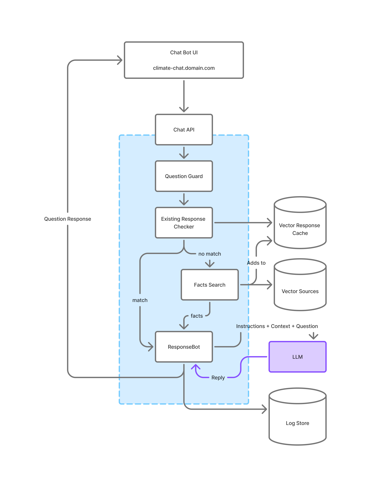

# climate-chatter

A helpful chatbot for responding to climate change related online comments with factual responses


### Brief

For this project we will be writing python to do the following:

* Use embedding to store the source docs in to a vector database
* Use an LLM via OpenRouter to take a context based on the incoming question whereby the context is constructed using the vector database embeddings to fetch related information to answer the question. The responding statement will aim to provide key arguments against a view point on climate change related topics such as "The sun doesn't shine at night so solar is pointless" could return various evidence to counter this such as battery price and adoption, the amount of power being produced by solar in 2026 etc. These question and responses will be stored in a database which provides a cache of known responses, this will be the "ResponseCache". This will also need to be a vector based db to allow for searching for near matches to variations on the same question.
* When an initial question comes in, it will first check the ResponseCache for answers using a vector search. If the confidence score is below a threshold (to be determined through testing later) the question will do the full LLM cycle.
* Once the answer facts have been established they need to then go through a further LLM phase (known as the ResponseBot LLM) which will aim to match the tone of the original question to provide an answer that isn't overly verbose or academic as the goal is for use in real world social media
* The ResponseBot LLM will later be extended to adjust what response can be achieved by the user, such as adding sarcasm or being more casual with language such as "LOL, ...."
* Guard rails will need to be included to prevent abuse of the chat bot including rate limits and checking the question is a climate related question and that it presents a sceptical view point
* Questions and Answers throughout the entire flow need to be stored for tracing issues in the future



## Ingestion

The source documents are loaded into the `sources` vector index (S3 Vectors) by a local
Python command-line tool. The plan and its results are in
[Project/Plans/02.Ingestion.md](Project/Plans/02.Ingestion.md); the infrastructure it writes
to is in [Infrastructure/README.md](Infrastructure/README.md).

### Setup

1. Install [uv](https://docs.astral.sh/uv/), then `uv sync` (Python 3.14 and the pinned
   dependencies from `uv.lock`).
2. Copy `.env.example` to `.env` and fill it in. Ingestion needs `AWS_PROFILE`,
   `MODEL_EMBEDDING`, `EMBEDDING_DIMENSION` and `INGEST_OPENROUTER_API_KEY`. If the key is
   left as its placeholder, it's read from SSM (`/climate-chat/ingest/openrouter-api-key`).
   The ingest key has its own OpenRouter credit cap.
3. Sign in to AWS (`aws sso login`) before the `load` stage or `evaluate --env`.
4. Download the PDFs into `sources/docs/` using the file names in
   [sources/index.md](sources/index.md). The folder is gitignored.

Tests and lint: `uv run pytest` and `uv run ruff check .` (no network or PDFs needed).

### Stages

Run each stage with `uv run python -m climate_chat.ingest <stage>`. Each stage reads and
writes the gitignored `build/` folder, so any of them can be re-run on its own. With no
`--source`, a stage processes every source in `sources/manifest.toml` marked
`ingest = true`; `--source 05` (repeatable) limits it.

| Stage | Does | Time for the whole corpus |
|---|---|---|
| `extract` | PDF to cleaned text per page (`build/text/`) | ~3 min |
| `chunk` | Text to ~500-token chunks with page ranges (`build/chunks/`) | seconds |
| `embed` | Chunks to vectors with `MODEL_EMBEDDING`, cached by content hash (`build/embeddings/`) | ~1 min, ~$0.02 |
| `load --env dev` | Vectors and metadata into that environment's `sources` index | ~20 s |
| `evaluate --env dev` | The 20 test myths in `eval/retrieval_myths.toml` against the live index, compared with an in-memory search | ~20 s |

- `load --dry-run` shows the chunks, new keys and keys to delete for each source, and
  writes nothing.
- Loads are idempotent: each source's chunks are written, then its old keys that weren't
  rewritten are deleted. A load without `--source` also removes sources that are no longer
  ingested.
- `embed` only pays for chunks whose text changed. `evaluate --in-memory` searches the
  cached vectors without touching AWS.
- `evaluate --env` exits non-zero if the live index and the in-memory search find
  different numbers of myths, which points to a loading problem.

### Re-ingesting (runbook)

Re-ingest when a source is added or replaced, when a web-page snapshot is re-captured, or
when the extraction or chunking code changes.

1. **Re-capture the web-page snapshots** if their data matters: #07, #08, #09, #25, #26,
   #27, #28 and #29 (and #10, though it isn't ingested). Print each page to PDF from a
   browser under its existing file name in `sources/docs/`, then update `captured` in
   `sources/manifest.toml` and the capture date in `sources/index.md`.
2. **For a new source:** save the PDF as `sources/docs/<id>-<name>.pdf`, add a row to
   `sources/index.md` (including its reuse terms) and a `[[source]]` entry to
   `sources/manifest.toml`, then run `uv run pytest`: a test checks that the two lists
   agree. Optionally add a myth it should answer to `eval/retrieval_myths.toml`.
3. **Rebuild the changed sources** (leave out `--source` to rebuild everything):

   ```bash
   uv run python -m climate_chat.ingest extract --source 07 --source 25
   uv run python -m climate_chat.ingest chunk --source 07 --source 25
   uv run python -m climate_chat.ingest embed --source 07 --source 25
   ```

   Check `extract`'s output for warnings (pages that look scanned) and for a source whose
   kept-text share is much lower than usual.
4. **Load and check dev:**

   ```bash
   uv run python -m climate_chat.ingest load --env dev --source 07 --source 25 --dry-run
   uv run python -m climate_chat.ingest load --env dev --source 07 --source 25
   uv run python -m climate_chat.ingest evaluate --env dev
   ```

   The evaluation runs all 20 myths, so it also catches a change that hurts other
   sources' retrieval. Expect 20/20 recall@5, matching the in-memory search.
5. **Repeat step 4 with `--env prod`.**

**Changing the embedding model** means re-embedding everything and replacing both indexes
if the dimension changes. Compare candidates first with `embed --model <id>` and
`evaluate --in-memory --model <a> --model <b>`, then follow plan 02's step 4.4 and the
Terraform notes in [Infrastructure/README.md](Infrastructure/README.md).
