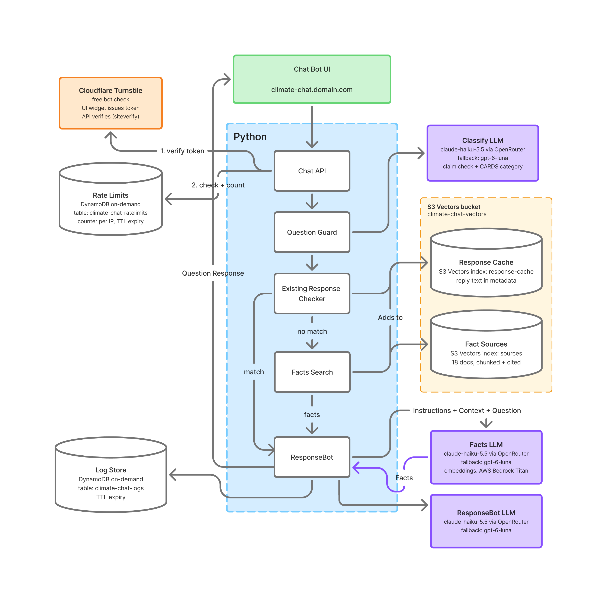

# climate-chatter

A helpful chatbot for responding to climate change related online comments with factual responses

The original [brief](Project/Brief.md) contains the v0 design.

The live demo site is available [https://climate-chat.peterlester.dev/](here)

# Background

I started this project to simply using embedding for some climate related research pdf files and then use an LLM to pull answers from the source data with citation.

This repo is a more thorough build out of this with move source data, a full AWS infrastructure managed by Terraform, logging, security, rate limiting, guardrails.

# Design Overview

More details can be found in [brief](Project/Design.md).

# Setup

To use this project you will need to:

1. Manually download the documents in [index.md](sources/index.md), you can add anything you like to these, they form the knowledge based of the chat-bot.
2. Setup the infrastructure on your own AWS account
3. Ingest the documents in to the vector database
4. Setup the API keys in the env variables

You can find all the details in [SETUP.md](SETUP.md)